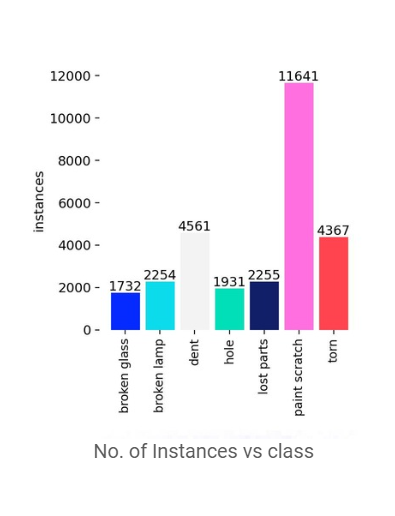
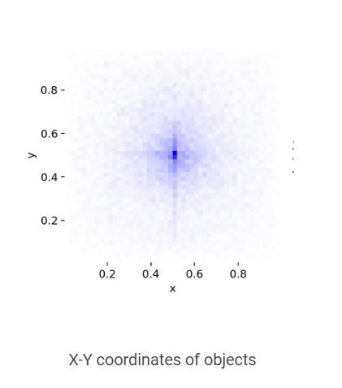
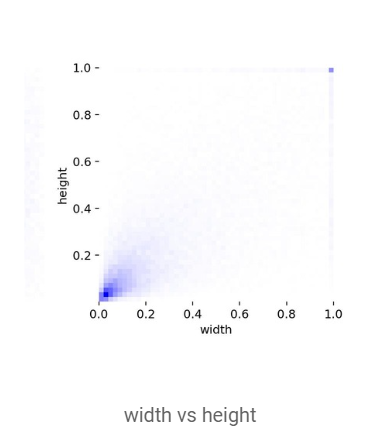
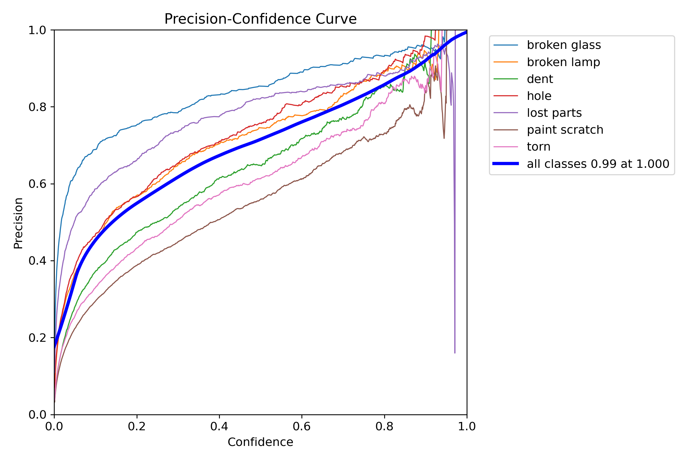
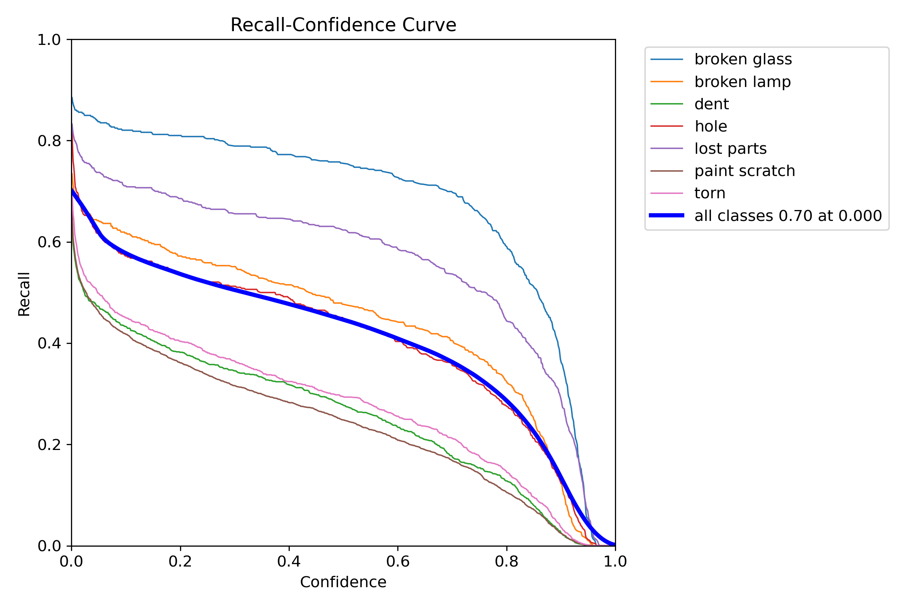
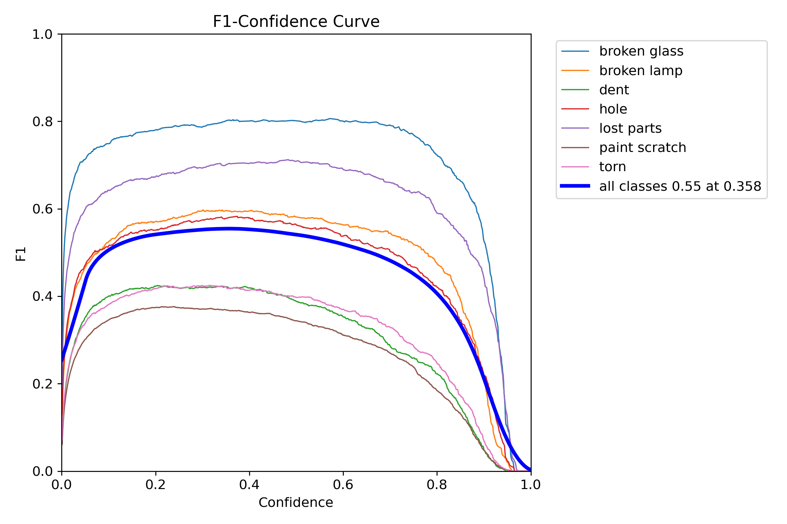
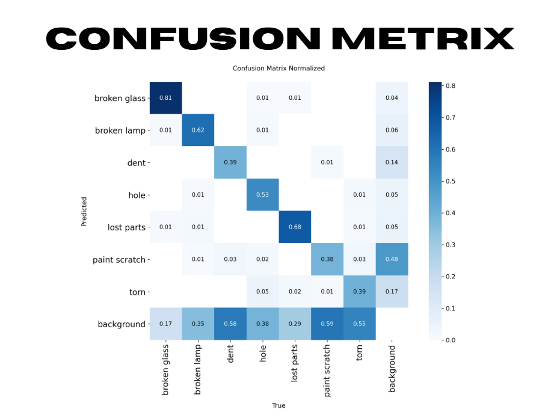

# Car Damage Detection

**One photo in. A damage map and an assessment report out.**

A deep-learning pipeline that takes a single photo of a car and returns:

1. whether the car is **damaged**,
2. a pixel-level **outline of every damaged area**, labelled with one of 7 damage types, and
3. a written **assessment report** covering location, severity and repair work.

Built as a Design Credit (DC) project at **IIT Jodhpur** under the guidance of **Prof. Anand Mishra**.

---

## Table of contents

- [How it works](#how-it-works)
- [Dataset: VehiDE](#dataset-vehide)
- [Models and training](#models-and-training)
- [Results](#results)
- [Getting started](#getting-started)
- [Retraining](#retraining)
- [Repository structure](#repository-structure)
- [Tech stack](#tech-stack)
- [Applications](#applications)
- [Limitations](#limitations)
- [Team](#team)
- [Acknowledgements](#acknowledgements)

---

## How it works

Three models are chained, each doing one job:

```
                     Car photo (Gradio upload)
                               │
              ┌────────────────┴────────────────┐
              ▼                                 ▼
   ┌─────────────────────┐          ┌──────────────────────────┐
   │ ResNet-50           │          │ YOLO26s-seg              │
   │ damaged or not?     │          │ masks + boxes, 7 classes │
   └──────────┬──────────┘          └────────────┬─────────────┘
              └────────────────┬─────────────────┘
                               ▼
                    ┌─────────────────────┐
                    │  Combine verdicts   │
                    └──────────┬──────────┘
          ┌────────────────────┼─────────────────────┐
          ▼                    ▼                     ▼
  Neither finds damage   Detector finds damage   Only classifier
  → "No damage"          → Qwen3.5 report        says damaged
    (no report call)                             → "Manual review"
          └────────────────────┼─────────────────────┘
                               ▼
         Results page: overlay, verdict, damage list, report
```

| Stage | What it does | File |
|---|---|---|
| **Upload** | Gradio page; models load once on the first request | `Backend/main.py`, `app/api/router.py` |
| **Classify** | ResNet-50 with a 2-class head on a 224×224 image → damaged / undamaged + confidence | `app/models/Resnet50/resnet50.py` |
| **Detect** | YOLO26s-seg runs once, at the photo's own size (640–1280 px), and returns a mask, box, class and confidence for each damaged area (threshold 0.25) | `app/models/YOLO26m/yolo26m.py` |
| **Combine** | A car is damaged if the detector finds damage, so one model's mistake cannot hide visible damage | `app/damage_pipeline.py` |
| **Report** | The overlay and class list go to Qwen3.5 (via the Hugging Face router), prompted as an insurance damage assessor | `app/utils/report.py` |
| **Display** | Segmented image, verdict, damage list and report | `app/api/router.py` |

**Design choices**

- **Early exit:** undamaged cars skip the slower, paid language-model call.
- **Safety net:** the detector checks every photo and can overrule the classifier.
- **Modular:** each stage can be retrained or swapped without touching the others.
- **Graceful fallback:** without an `HF_TOKEN`, everything except the written report still works.

---

## Dataset: VehiDE

[VehiDE](https://www.kaggle.com/datasets/hendrichscullen/vehide-dataset-automatic-vehicle-damage-detection) contains **13,945 photos of damaged cars** with **32,000+ damage instances**, each outlined as a polygon. Labels are in Vietnamese; our converter maps them to English:

| VehiDE label | Class | Instances in our training split |
|---|---|---|
| `tray_son` | Paint scratch | 11,641 |
| `mop_lom` | Dent | 4,561 |
| `rach` | Torn | 4,367 |
| `mat_bo_phan` | Lost parts | 2,255 |
| `be_den` | Broken lamp | 2,254 |
| `thung` | Hole | 1,931 |
| `vo_kinh` | Broken glass | 1,732 |
| | **Total** | **28,741** |

Paint scratches make up 40% of all instances. Most damage regions are small, typically under a tenth of the photo's width, which is why the detector trains at 1280 px.

<p>
  
  
  
</p>

---

## Models and training

| Setting | Detector | Classifier |
|---|---|---|
| Model | YOLO26s-seg | ResNet-50 |
| Starting point | Pretrained YOLO26s | ImageNet weights, new 2-class head |
| Image size | 1280 px | 224 px |
| Epochs | 150 | 10 |
| Optimizer | MuSGD, batch 16 | Adam |
| Output | Masks + boxes, 7 classes | Damaged / undamaged |

- **Split:** random 80/20 of VehiDE's training images (seed 42).
- **Hardware:** the detector trained on a CUDA GPU server for about 33 hours.

---

## Results

YOLO26s-seg on the validation split (best epoch 148 of 150):

| Metric | Masks | Boxes |
|---|---|---|
| Precision | 0.652 | 0.663 |
| Recall | 0.490 | 0.505 |
| **mAP50** | **0.515** | 0.541 |
| mAP50-95 | 0.297 | 0.344 |

- Validation mAP50 rose quickly and levelled off after epoch 100: 0.508 at epoch 100, 0.515 at epoch 150.
- Precision is higher than recall: reported damage is usually correct, and most misses are small scratches and dents.
- For per-class numbers of the deployed model, run `python evaluate.py --imgsz 1280`.

<p>
  
  
  
</p>


### The pipeline in action

**Undamaged vehicle:**


**Damaged vehicle** (front bumper: lost parts and torn material detected, outlined and described):


---

## Getting started

Requires Python 3.10+. A GPU is optional for running the app.

### 1. Clone and install

```bash
git clone -b prefinal https://github.com/kb2717/DC_Manufacturing.git
cd DC_Manufacturing/dc_project/dc_proj/Backend
python -m venv .venv
source .venv/bin/activate          # Windows: .venv\Scripts\activate
pip install -r requirements.txt
```

### 2. Configure

```bash
cp config.yaml.example config.yaml
cp .env.example .env               # optional: add HF_TOKEN=... for the written report
```

### 3. Download the trained weights

```bash
python download_weights.py
```

This downloads `resnet50_damage.pth` and `yolo26_damage.pt` from the repository's [GitHub Release `v1.0`](https://github.com/kb2717/DC_Manufacturing/releases/tag/v1.0) into `Backend/weights/`.

### 4. Run

```bash
python main.py                     # open http://127.0.0.1:7860
```

Set `APP_SHARE=1` before `python main.py` to also get a public `*.gradio.live` link. Upload a car photo and press **Submit**.

---

## Retraining

Training needs a GPU. Use [`notebooks/train_vehide.ipynb`](notebooks/train_vehide.ipynb) on Kaggle or Colab, or run the scripts directly on a GPU server.

**Datasets**

| Dataset | Used for |
|---|---|
| [VehiDE](https://www.kaggle.com/datasets/hendrichscullen/vehide-dataset-automatic-vehicle-damage-detection) | Detector training; the *damaged* class of the classifier |
| [Car Damage Dataset](https://www.kaggle.com/datasets/vinayjose/car-damage-dataset) (`01-whole`, `00-damage`) | Undamaged and whole-car damaged photos for the classifier |

**Steps** (from `Backend/`, after setting the data paths in `config.yaml`):

```bash
python -m app.models.YOLO26m.data_converter   # VehiDE polygons -> YOLO labels
python -m app.models.Resnet50.resnet50        # train the classifier
python -m app.models.YOLO26m.yolo26m          # train the detector (resumes if interrupted)
python evaluate.py --imgsz 1280               # metrics -> results/metrics.md
```

Two training profiles:
- **`fast`:** 640 px, 60 epochs, fits one 12-hour Kaggle session.
- **`full`:** 1280 px, 150 epochs, reproduces the released model.

---

## Repository structure

```
dc_proj/
├── Backend/
│   ├── main.py                    # starts the Gradio app
│   ├── evaluate.py                # metrics on the validation split
│   ├── download_weights.py        # fetches weights from the GitHub Release
│   ├── config.yaml.example        # paths and settings (copy to config.yaml)
│   ├── .env.example               # HF_TOKEN for the report
│   ├── requirements.txt
│   └── app/
│       ├── config.py              # loads config.yaml and .env
│       ├── damage_pipeline.py     # chains the three stages
│       ├── api/router.py          # Gradio interface
│       ├── utils/report.py        # Qwen3.5 report
│       └── models/
│           ├── Resnet50/resnet50.py
│           └── YOLO26m/
│               ├── yolo26m.py         # detector training + inference
│               └── data_converter.py  # VehiDE -> YOLO dataset
├── notebooks/train_vehide.ipynb   # GPU retraining workflow
├── assets/                        # dataset plots and evaluation curves
├── CHANGELOG.md
└── README.md
```

`Backend/weights/`, `config.yaml` and `.env` are git-ignored on purpose.

---

## Tech stack

| Area | Tools |
|---|---|
| Deep learning | PyTorch, torchvision, Ultralytics YOLO26 |
| Language model | Qwen3.5 via the Hugging Face router, OpenAI Python client, httpx |
| App and config | Gradio, Pillow, YAML, python-dotenv |
| Training and delivery | CUDA GPU server, Kaggle notebook, GitHub Releases |

---

## Applications

- **Insurance claims:** start a claim from a customer's photo, with damage outlined and a draft report.
- **Car rentals and leasing:** compare pick-up and return photos for new damage.
- **Used-car marketplaces:** quick damage check before inspection or sale.
- **Fleets and ride-hailing:** flag damaged cars after each shift.

---

## Limitations

- **Uneven across damage types.** The training data has 6.7× more paint scratches than broken glass, so rarer types have fewer examples.
- **Accuracy has plateaued.** Mask mAP50 rose only 0.007 in the last 50 epochs; more or better-balanced data, not longer training, is the next lever.
- **Small damage is missed most.** Mask recall is 0.490, mostly thin scratches and dents.
- **Classifier needs retraining.** The released classifier was trained without undamaged cars, so it can flag undamaged cars for manual review. The detector override catches visible damage, and the retraining notebook adds undamaged photos.
- **Report needs an API.** Qwen3.5 requires an `HF_TOKEN`, a network connection and quota.

---

## Team

| Name | Roll number |
|---|---|
| Tejal | B25CS1069 |
| Khyati Mankar | B25CS1030 |
| Angel Agarwal | B25CS1005 |
| Khanak Bansal | B25CS1028 |

**Guide:** Prof. Anand Mishra. Design Credit (DC), IIT Jodhpur.

---

## Acknowledgements

- [VehiDE dataset](https://www.kaggle.com/datasets/hendrichscullen/vehide-dataset-automatic-vehicle-damage-detection) for vehicle damage images and annotations
- [Ultralytics YOLO](https://github.com/ultralytics/ultralytics)
- [Qwen](https://github.com/QwenLM) via the Hugging Face router
- [Gradio](https://www.gradio.app/)
- Baseline weights trained by Rakshit Khatri (April 2026)
